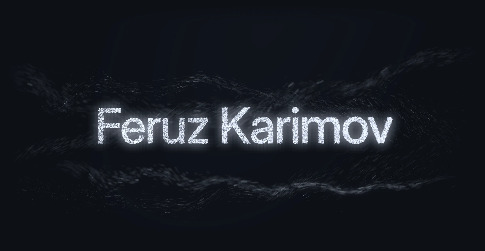
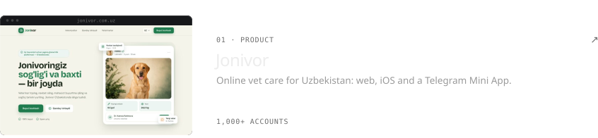
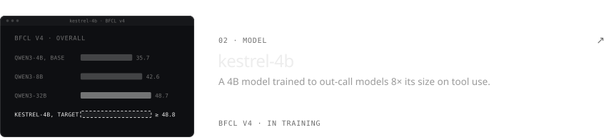
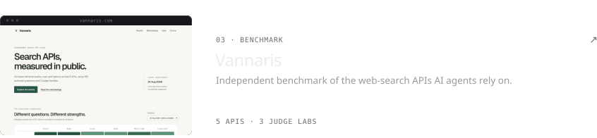
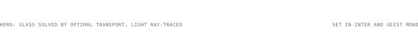

<a href="https://github.com/feruzkarimovv/feruzkarimovv/tree/main/src/render"><picture><source media="(prefers-reduced-motion: reduce) and (max-width: 1011px) and (prefers-color-scheme:light)" srcset="assets/hero.compact.light.webp"><source media="(prefers-reduced-motion: reduce) and (max-width: 1011px)" srcset="assets/hero.compact.dark.webp"><source media="(prefers-reduced-motion: reduce) and (prefers-color-scheme:light)" srcset="assets/hero.wide.light.webp"><source media="(prefers-reduced-motion: reduce)" srcset="assets/hero.wide.dark.webp"><source media="(max-width: 1011px) and (prefers-color-scheme:light)" type="image/avif" srcset="assets/hero.compact.light.avif"><source media="(max-width: 1011px)" type="image/avif" srcset="assets/hero.compact.dark.avif"><source media="(prefers-color-scheme: light)" type="image/avif" srcset="assets/hero.wide.light.avif"><source type="image/avif" srcset="assets/hero.wide.dark.avif"><source media="(max-width: 1011px) and (prefers-color-scheme:light)" srcset="assets/hero.compact.light.webp"><source media="(max-width: 1011px)" srcset="assets/hero.compact.dark.webp"><source media="(prefers-color-scheme: light)" srcset="assets/hero.wide.light.webp"></picture></a>
<a href="https://github.com/feruzkarimovv/feruzkarimovv/tree/main/src/render"><picture><source media="(max-width: 1011px) and (prefers-color-scheme:light)" srcset="assets/caption.compact.light.svg"><source media="(max-width: 1011px)" srcset="assets/caption.compact.dark.svg"><source media="(prefers-color-scheme: light)" srcset="assets/caption.light.svg"></picture></a>
<a href="https://github.com/feruzkarimovv?tab=repositories"><picture><source media="(max-width: 1011px) and (prefers-color-scheme:light)" srcset="assets/h-work.compact.light.svg"><source media="(max-width: 1011px)" srcset="assets/h-work.compact.dark.svg"><source media="(prefers-color-scheme: light)" srcset="assets/h-work.light.svg"></picture></a>
<a href="https://jonivor.com.uz"><picture><source media="(max-width: 1011px) and (prefers-color-scheme:light)" srcset="assets/work-jonivor.compact.light.svg"><source media="(max-width: 1011px)" srcset="assets/work-jonivor.compact.dark.svg"><source media="(prefers-color-scheme: light)" srcset="assets/work-jonivor.light.svg"></picture></a>
<a href="https://gorilla.cs.berkeley.edu/leaderboard.html"><picture><source media="(max-width: 1011px) and (prefers-color-scheme:light)" srcset="assets/work-kestrel.compact.light.svg"><source media="(max-width: 1011px)" srcset="assets/work-kestrel.compact.dark.svg"><source media="(prefers-color-scheme: light)" srcset="assets/work-kestrel.light.svg"></picture></a>
<a href="https://vannaris.com"><picture><source media="(max-width: 1011px) and (prefers-color-scheme:light)" srcset="assets/work-vannaris.compact.light.svg"><source media="(max-width: 1011px)" srcset="assets/work-vannaris.compact.dark.svg"><source media="(prefers-color-scheme: light)" srcset="assets/work-vannaris.light.svg"></picture></a>
<a href="https://github.com/feruzkarimovv?tab=repositories"><picture><source media="(max-width: 1011px) and (prefers-color-scheme:light)" srcset="assets/h-also.compact.light.svg"><source media="(max-width: 1011px)" srcset="assets/h-also.compact.dark.svg"><source media="(prefers-color-scheme: light)" srcset="assets/h-also.light.svg"></picture></a>
<a href="https://github.com/feruzkarimovv/between-visits"><picture><source media="(max-width: 1011px) and (prefers-color-scheme:light)" srcset="assets/also-between-visits.compact.light.svg"><source media="(max-width: 1011px)" srcset="assets/also-between-visits.compact.dark.svg"><source media="(prefers-color-scheme: light)" srcset="assets/also-between-visits.light.svg"></picture></a>
<a href="https://github.com/feruzkarimovv/gha-graph"><picture><source media="(max-width: 1011px) and (prefers-color-scheme:light)" srcset="assets/also-gha-graph.compact.light.svg"><source media="(max-width: 1011px)" srcset="assets/also-gha-graph.compact.dark.svg"><source media="(prefers-color-scheme: light)" srcset="assets/also-gha-graph.light.svg"></picture></a>
<a href="https://github.com/feruzkarimovv/vibeduel"><picture><source media="(max-width: 1011px) and (prefers-color-scheme:light)" srcset="assets/also-vibeduel.compact.light.svg"><source media="(max-width: 1011px)" srcset="assets/also-vibeduel.compact.dark.svg"><source media="(prefers-color-scheme: light)" srcset="assets/also-vibeduel.light.svg"></picture></a>
<a href="https://github.com/feruzkarimovv/vibecheck"><picture><source media="(max-width: 1011px) and (prefers-color-scheme:light)" srcset="assets/also-vibecheck.compact.light.svg"><source media="(max-width: 1011px)" srcset="assets/also-vibecheck.compact.dark.svg"><source media="(prefers-color-scheme: light)" srcset="assets/also-vibecheck.light.svg"></picture></a>
<a href="https://x.com/feruzkrm"><picture><source media="(max-width: 1011px) and (prefers-color-scheme:light)" srcset="assets/h-now.compact.light.svg"><source media="(max-width: 1011px)" srcset="assets/h-now.compact.dark.svg"><source media="(prefers-color-scheme: light)" srcset="assets/h-now.light.svg"></picture></a>
<a href="https://x.com/feruzkrm"><picture><source media="(max-width: 1011px) and (prefers-color-scheme:light)" srcset="assets/now.compact.light.svg"><source media="(max-width: 1011px)" srcset="assets/now.compact.dark.svg"><source media="(prefers-color-scheme: light)" srcset="assets/now.light.svg"></picture></a>
<a href="mailto:feruz.karimov@rutgers.edu"><picture><source media="(max-width: 1011px) and (prefers-color-scheme:light)" srcset="assets/h-contact.compact.light.svg"><source media="(max-width: 1011px)" srcset="assets/h-contact.compact.dark.svg"><source media="(prefers-color-scheme: light)" srcset="assets/h-contact.light.svg"></picture></a>
<a href="mailto:feruz.karimov@rutgers.edu"><picture><source media="(max-width: 1011px) and (prefers-color-scheme:light)" srcset="assets/contact-email.compact.light.svg"><source media="(max-width: 1011px)" srcset="assets/contact-email.compact.dark.svg"><source media="(prefers-color-scheme: light)" srcset="assets/contact-email.light.svg"></picture></a>
<a href="https://x.com/feruzkrm"><picture><source media="(max-width: 1011px) and (prefers-color-scheme:light)" srcset="assets/contact-x.compact.light.svg"><source media="(max-width: 1011px)" srcset="assets/contact-x.compact.dark.svg"><source media="(prefers-color-scheme: light)" srcset="assets/contact-x.light.svg"></picture></a>
<a href="https://www.linkedin.com/in/feruzlkarimov"><picture><source media="(max-width: 1011px) and (prefers-color-scheme:light)" srcset="assets/contact-linkedin.compact.light.svg"><source media="(max-width: 1011px)" srcset="assets/contact-linkedin.compact.dark.svg"><source media="(prefers-color-scheme: light)" srcset="assets/contact-linkedin.light.svg"></picture></a>
<a href="https://feruz-karimov.dev"><picture><source media="(max-width: 1011px) and (prefers-color-scheme:light)" srcset="assets/contact-site.compact.light.svg"><source media="(max-width: 1011px)" srcset="assets/contact-site.compact.dark.svg"><source media="(prefers-color-scheme: light)" srcset="assets/contact-site.light.svg"></picture></a>
<a href="https://github.com/feruzkarimovv/feruzkarimovv/tree/main/src"><picture><source media="(max-width: 1011px) and (prefers-color-scheme:light)" srcset="assets/footer.compact.light.svg"><source media="(max-width: 1011px)" srcset="assets/footer.compact.dark.svg"><source media="(prefers-color-scheme: light)" srcset="assets/footer.light.svg"></picture></a>

